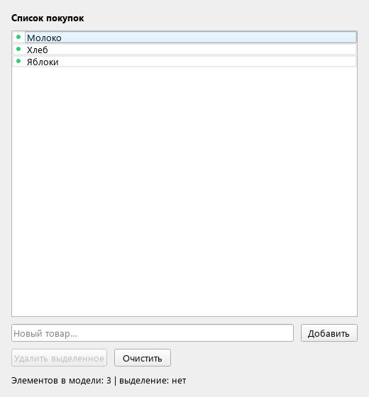
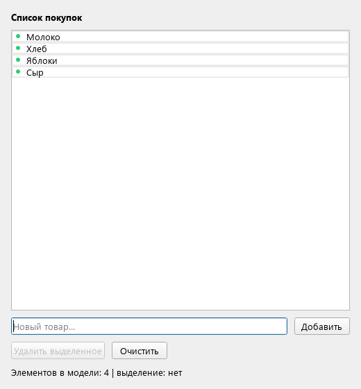
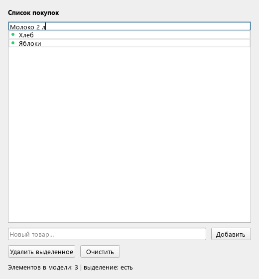
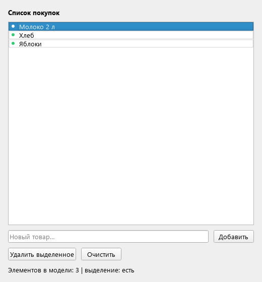
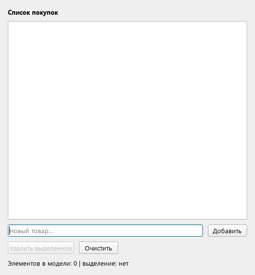

# Лабораторная работа № 5

**Дисциплина:** Основы кроссплатформенного программирования<br>
**Тема:** Менеджер списка покупок — Model-View и делегат<br>
**Выполнил:** Кудаев Максим Сергеевич<br>
**Группа:** ПИЖ-б-о-24-1<br>
**Дата:** 10 ноября 2026 года<br>
**Репозиторий:** [SETAVR/ShoppingList](https://github.com/SETAVR/ShoppingList)

## Цель работы

Освоить архитектуру Model-View в Qt на практике: научиться отделять данные (`QStringListModel`) от их отображения (`QListView`), реализовать базовые операции CRUD — добавление, удаление, очистку — и создать кастомный делегат для редактирования элементов по двойному клику. Понять, почему Model-View предпочтительнее «всё-в-одном» виджетов (`QListWidget`) при работе с динамическими данными.

## Постановка задачи

Разработать приложение **ShoppingList** на Qt Widgets с программным построением интерфейса без `.ui`:

1. Хранить список покупок в `QStringListModel`, отображать его через `QListView`.
2. Добавлять, удалять и очищать элементы через методы модели.
3. Открывать редактор строки только по двойному клику.
4. Реализовать `PurchaseDelegate`, переопределив `createEditor()`, `setEditorData()`, `setModelData()`, `updateEditorGeometry()` и `paint()`.
5. Рисовать маркер и рамку ячейки с сохранением и восстановлением состояния `QPainter`.
6. Показать изменения модели, работу редактора и отрисовку сообщениями `[CRUD]`, `[EDITOR]`, `[PAINT]`.
7. Объяснить преимущества отдельной модели данных и границы применения `Q_OBJECT`.

## Теоретическое обоснование

В связке Model-View-Delegate модель хранит данные и сообщает об изменениях, представление отображает их и обрабатывает выбор, делегат рисует отдельные ячейки и создаёт редакторы. В работе модель — единственный источник содержимого списка: кнопки не создают и не удаляют элементы внутри view.

`QStringListModel` хранит одномерный список строк. Доступ к элементу выполняется через `QModelIndex`: номер строки, столбца и принадлежность модели. `Qt::DisplayRole` используется для показа, `Qt::EditRole` — для редактирования. В QStringListModel обе роли предоставляют текст строки.

При добавлении вызываются `insertRow()` и `setData()`, при удалении — `removeRow()`, при очистке — `setStringList({})`. Модель излучает `rowsInserted`, `rowsRemoved`, `dataChanged` и `modelReset`. Подключённый через `setModel()` список обновляется автоматически. Счётчик элементов также обновляется по сигналам модели.

`QListView::setEditTriggers(QAbstractItemView::DoubleClicked)` оставляет единственный пользовательский триггер открытия редактора — двойной клик. `createEditor()` возвращает QLineEdit с переданным родителем, `setEditorData()` заполняет его из модели, `setModelData()` записывает текст обратно в модель, а `updateEditorGeometry()` размещает редактор по `option.rect`.

В `paint()` сначала рисуются стандартные текст и выделение, затем собственные маркер и рамка. Под точку отводится полоса шириной 18 пикселей, чтобы она не перекрывала текст. `painter->save()` сохраняет состояние пера, кисти, шрифта, преобразований и других параметров; `restore()` возвращает его перед рисованием следующей ячейки.

`QListWidget` удобен для простых списков и тоже использует модель внутри, однако данные управляются через его элементы. Отдельная модель делает разделение ответственности явным, позволяет подключить несколько представлений к одним данным и использовать прокси-модели для сортировки и фильтрации. В этой работе это разделение показано без добавления сортировки, фильтрации или сохранения в файл.

Делегат только переопределяет виртуальные методы и не вводит собственных сигналов, слотов или свойств, поэтому ему не нужен `Q_OBJECT`. MainWindow объявляет собственные слоты кнопок и содержит этот макрос; qmake запускает MOC при сборке.

## Сборка и запуск

Откройте `ShoppingList.pro` в Qt Creator, выберите Desktop kit и выполните сборку и запуск. Требуются Qt Widgets и компилятор с поддержкой C++17. Файлы `.ui` не используются.

Из корня репозитория в терминале выбранного Qt-комплекта:

```sh
mkdir build
cd build
qmake ../ShoppingList.pro
make
./ShoppingList
```

В Windows с MinGW вместо `make` используется `mingw32-make`, с MSVC — `nmake` в Developer Command Prompt. Для release-сборки MSVC исполняемый файл находится в `build/release/ShoppingList.exe`. При запуске вне Qt Creator каталог `bin` выбранного Qt должен быть в `PATH`. Сообщения qDebug доступны в Application Output; в Windows для вывода в stderr можно задать `QT_FORCE_STDERR_LOGGING=1`.

## Кнопки и триггеры

| Действие | Поведение |
| --- | --- |
| «Добавить» | Добавляет непустой текст из поля ввода в конец модели; крайние пробелы удаляются |
| Enter в поле нового товара | Выполняет то же добавление |
| Одиночный клик по строке | Выделяет элемент, не открывая редактор |
| «Удалить выделенное» | Удаляет выделенную строку через модель; без выделения кнопка недоступна |
| «Очистить» | Сбрасывает весь список через `setStringList({})` |
| Двойной клик по строке | Создаёт встроенный редактор с текущим текстом |
| Enter или переход фокуса из редактора | Сохраняет правку в модель |
| Escape в редакторе | Закрывает редактор без сохранения правки |

## Листинг кода с комментариями

<details>
<summary>ShoppingList.pro</summary>

```qmake
QT += widgets
CONFIG += c++17 console
CONFIG -= app_bundle
TARGET = ShoppingList
TEMPLATE = app

SOURCES += main.cpp mainwindow.cpp purchase_delegate.cpp
HEADERS += mainwindow.h purchase_delegate.h

msvc:QMAKE_CXXFLAGS += /utf-8
```

</details>

<details>
<summary>purchase_delegate.h</summary>

```cpp
#ifndef PURCHASE_DELEGATE_H
#define PURCHASE_DELEGATE_H

#include <QStyledItemDelegate>

// No Q_OBJECT: this class only overrides virtual methods, without new signals.
class PurchaseDelegate : public QStyledItemDelegate
{
public:
    explicit PurchaseDelegate(QObject *parent = nullptr);

    QWidget *createEditor(QWidget *parent, const QStyleOptionViewItem &option,
                          const QModelIndex &index) const override;
    void setEditorData(QWidget *editor, const QModelIndex &index) const override;
    void setModelData(QWidget *editor, QAbstractItemModel *model,
                      const QModelIndex &index) const override;
    void updateEditorGeometry(QWidget *editor, const QStyleOptionViewItem &option,
                              const QModelIndex &index) const override;
    void paint(QPainter *painter, const QStyleOptionViewItem &option,
               const QModelIndex &index) const override;
};

#endif
```

</details>

<details>
<summary>purchase_delegate.cpp</summary>

```cpp
#include "purchase_delegate.h"

#include <QColor>
#include <QDebug>
#include <QLineEdit>
#include <QPainter>
#include <QPalette>
#include <QPen>
#include <QStyle>

PurchaseDelegate::PurchaseDelegate(QObject *parent) : QStyledItemDelegate(parent)
{
    qDebug() << "[DELEGATE] Created PurchaseDelegate";
}

QWidget *PurchaseDelegate::createEditor(QWidget *parent,
                                       const QStyleOptionViewItem &,
                                       const QModelIndex &index) const
{
    // The view owns the editor through its supplied parent.
    qDebug() << "[EDITOR] createEditor, row:" << index.row();
    return new QLineEdit(parent);
}

void PurchaseDelegate::setEditorData(QWidget *editor, const QModelIndex &index) const
{
    if (auto *lineEdit = qobject_cast<QLineEdit *>(editor)) {
        const QString value = index.data(Qt::EditRole).toString();
        lineEdit->setText(value);
        qDebug() << "[EDITOR] setEditorData:" << value;
    }
}

void PurchaseDelegate::setModelData(QWidget *editor, QAbstractItemModel *model,
                                   const QModelIndex &index) const
{
    if (auto *lineEdit = qobject_cast<QLineEdit *>(editor)) {
        // Change the model, not the view: dataChanged triggers the update.
        const QString value = lineEdit->text();
        model->setData(index, value, Qt::EditRole);
        qDebug() << "[EDITOR] setModelData, saved:" << value;
    }
}

void PurchaseDelegate::updateEditorGeometry(QWidget *editor,
                                           const QStyleOptionViewItem &option,
                                           const QModelIndex &) const
{
    editor->setGeometry(option.rect);
}

void PurchaseDelegate::paint(QPainter *painter, const QStyleOptionViewItem &option,
                            const QModelIndex &index) const
{
    const int gutter = 18;
    const int dot = 6;
    const bool selected = option.state & QStyle::State_Selected;

    // Restore every painter setting, including those changed by the overlay.
    painter->save();
    if (selected)
        painter->fillRect(option.rect, option.palette.brush(QPalette::Highlight));

    // Reserve a left gutter so the marker does not overlap the text.
    QStyleOptionViewItem textOption(option);
    textOption.rect.adjust(gutter, 0, 0, 0);
    QStyledItemDelegate::paint(painter, textOption, index);

    painter->setRenderHint(QPainter::Antialiasing, true);
    painter->setBrush(selected ? option.palette.color(QPalette::HighlightedText)
                               : QColor("#2ecc71"));
    painter->setPen(Qt::NoPen);
    painter->drawEllipse(option.rect.left() + (gutter - dot) / 2,
                         option.rect.center().y() - dot / 2, dot, dot);
    painter->setBrush(Qt::NoBrush);
    painter->setPen(QPen(QColor(0, 0, 0, 40), 1));
    painter->drawRect(option.rect.adjusted(1, 1, -1, -1));
    painter->restore();

    qDebug() << "[PAINT] row:" << index.row()
             << "text:" << index.data(Qt::DisplayRole).toString();
}
```

</details>

<details>
<summary>mainwindow.h</summary>

```cpp
#ifndef MAINWINDOW_H
#define MAINWINDOW_H

#include <QWidget>

class QStringListModel;
class QListView;
class QLineEdit;
class QLabel;
class QPushButton;

class MainWindow : public QWidget
{
    Q_OBJECT
public:
    explicit MainWindow(QWidget *parent = nullptr);
    ~MainWindow() override;

private slots:
    void addItem();
    void removeSelected();
    void clearAll();

private:
    void setupUi();
    void refreshStatus();

    QStringListModel *m_model = nullptr;
    QListView *m_view = nullptr;
    QLineEdit *m_input = nullptr;
    QLabel *m_status = nullptr;
    QPushButton *m_removeButton = nullptr;
};

#endif
```

</details>

<details>
<summary>mainwindow.cpp</summary>

```cpp
#include "mainwindow.h"
#include "purchase_delegate.h"

#include <QDebug>
#include <QHBoxLayout>
#include <QItemSelectionModel>
#include <QLabel>
#include <QLineEdit>
#include <QListView>
#include <QPushButton>
#include <QStringListModel>
#include <QVBoxLayout>

MainWindow::MainWindow(QWidget *parent) : QWidget(parent)
{
    setupUi();
    refreshStatus();
    qDebug() << "[INIT] Data belongs to the model; the view displays it";
}

MainWindow::~MainWindow()
{
    qDebug() << "[DESTROY] MainWindow";
}

void MainWindow::setupUi()
{
    setWindowTitle(QStringLiteral("Менеджер списка покупок — Model-View"));
    resize(520, 560);
    auto *root = new QVBoxLayout(this);
    root->setContentsMargins(16, 16, 16, 16);
    root->setSpacing(10);
    root->addWidget(new QLabel(QStringLiteral("<b>Список покупок</b>"), this));

    m_model = new QStringListModel(this);
    m_model->setObjectName("shoppingModel");
    m_model->setStringList({QStringLiteral("Молоко"), QStringLiteral("Хлеб"),
                            QStringLiteral("Яблоки")});
    m_view = new QListView(this);
    m_view->setObjectName("shoppingView");
    m_view->setModel(m_model);
    m_view->setSelectionMode(QAbstractItemView::SingleSelection);
    m_view->setEditTriggers(QAbstractItemView::DoubleClicked);
    m_view->setItemDelegate(new PurchaseDelegate(m_view));
    root->addWidget(m_view, 1);

    auto *inputRow = new QHBoxLayout;
    m_input = new QLineEdit(this);
    m_input->setObjectName("newItem");
    m_input->setPlaceholderText(QStringLiteral("Новый товар…"));
    auto *addButton = new QPushButton(QStringLiteral("Добавить"), this);
    addButton->setObjectName("addButton");
    inputRow->addWidget(m_input, 1);
    inputRow->addWidget(addButton);
    root->addLayout(inputRow);

    auto *buttonRow = new QHBoxLayout;
    m_removeButton = new QPushButton(QStringLiteral("Удалить выделенное"), this);
    m_removeButton->setObjectName("removeButton");
    auto *clearButton = new QPushButton(QStringLiteral("Очистить"), this);
    clearButton->setObjectName("clearButton");
    buttonRow->addWidget(m_removeButton);
    buttonRow->addWidget(clearButton);
    buttonRow->addStretch();
    root->addLayout(buttonRow);
    m_status = new QLabel(this);
    m_status->setObjectName("status");
    m_status->setWordWrap(true);
    root->addWidget(m_status);

    connect(addButton, &QPushButton::clicked, this, &MainWindow::addItem);
    connect(m_input, &QLineEdit::returnPressed, this, &MainWindow::addItem);
    connect(m_removeButton, &QPushButton::clicked, this, &MainWindow::removeSelected);
    connect(clearButton, &QPushButton::clicked, this, &MainWindow::clearAll);
    connect(m_view->selectionModel(), &QItemSelectionModel::selectionChanged,
            this, &MainWindow::refreshStatus);
    connect(m_view->selectionModel(), &QItemSelectionModel::currentChanged,
            this, &MainWindow::refreshStatus);
    // Counts follow the model signals, including direct changes to the model.
    connect(m_model, &QStringListModel::rowsInserted, this, &MainWindow::refreshStatus);
    connect(m_model, &QStringListModel::rowsRemoved, this, &MainWindow::refreshStatus);
    connect(m_model, &QStringListModel::modelReset, this, &MainWindow::refreshStatus);
}

void MainWindow::addItem()
{
    const QString text = m_input->text().trimmed();
    if (text.isEmpty()) {
        qDebug() << "[CRUD] addItem: empty input ignored";
        return;
    }
    const int row = m_model->rowCount();
    m_model->insertRow(row);
    m_model->setData(m_model->index(row, 0), text, Qt::EditRole);
    m_input->clear();
    m_input->setFocus();
    qDebug() << "[CRUD] addItem:" << text << "rows:" << m_model->rowCount();
}

void MainWindow::removeSelected()
{
    const QModelIndex index = m_view->currentIndex();
    if (!index.isValid() || !m_view->selectionModel()->isSelected(index)) {
        qDebug() << "[CRUD] removeSelected: no selection";
        return;
    }
    const int row = index.row();
    m_model->removeRow(row);
    qDebug() << "[CRUD] removeSelected, row:" << row << "remaining:" << m_model->rowCount();
}

void MainWindow::clearAll()
{
    m_model->setStringList({});
    qDebug() << "[CRUD] clearAll: model reset";
}

void MainWindow::refreshStatus()
{
    const QModelIndex current = m_view->currentIndex();
    const bool selected = current.isValid() && m_view->selectionModel()->isSelected(current);
    m_status->setText(QStringLiteral("Элементов в модели: %1 | выделение: %2")
                          .arg(m_model->rowCount())
                          .arg(selected ? QStringLiteral("есть") : QStringLiteral("нет")));
    m_removeButton->setEnabled(selected);
}
```

</details>

<details>
<summary>main.cpp</summary>

```cpp
#include <QApplication>
#include "mainwindow.h"

int main(int argc, char *argv[])
{
    QApplication app(argc, argv);
    MainWindow window;
    window.show();
    return app.exec();
}
```

</details>

## Пример работы программы

Приложение собрано и проверено на Windows 10 x64 с Qt 6.8.3 и MSVC x64. Фактический протокол: [docs/session.txt](docs/session.txt). Проверены операции модели, редактирование, отсутствие редактора по одиночному клику и F2, расположение QLineEdit и сохранение состояния QPainter. Итог проверки: **8 passed, 0 failed**, включая служебные начало и завершение набора.

| № | Действие | Результат |
| --- | --- | --- |
| 1 | Запустить приложение | В модели три строки: «Молоко», «Хлеб», «Яблоки»; видны маркеры и рамки |
| 2 | Ввести «Сыр» и нажать «Добавить» | В модель добавлена четвёртая строка, view обновился автоматически |
| 3 | Попробовать добавить пробелы | Список не изменяется; в журнале пустой ввод отмечен как пропущенный |
| 4 | Ввести «Кофе» и нажать Enter | В модель добавлена пятая строка |
| 5 | Выделить «Хлеб» и удалить | Строка удалена через removeRow(), остаётся четыре покупки |
| 6 | Дважды нажать на «Молоко» | QLineEdit открывается на месте строки и содержит исходный текст |
| 7 | Заменить текст на «Молоко 2 л» и нажать Enter | Изменение записано через setData(), строка показывает новый текст |
| 8 | Изменить другую строку и нажать Escape | Правка отменяется, исходный текст остаётся |
| 9 | Нажать «Очистить» | Модель пуста, счётчик равен нулю, кнопка удаления недоступна |

**Начальное окно:**



**Добавление товара через модель:**



**Редактор строки по двойному клику:**



**Результат сохранения правки:**



**Очистка модели:**



Фрагменты фактического журнала:

```text
[CRUD] addItem: "Сыр" rows: 4
[CRUD] removeSelected, row: 1 remaining: 4
[CRUD] clearAll: model reset
[EDITOR] createEditor, row: 0
[EDITOR] setEditorData: "Молоко"
[EDITOR] setModelData, saved: "Молоко 2 л"
[PAINT] row: 0 text: "Молоко 2 л"
```

## Разбор ошибок и решений

### 1. Изменение текста только в редакторе

Сам QLineEdit не меняет данные QStringListModel. Если не реализовать `setModelData()`, после закрытия редактора останется старый текст. Решение: читать текст редактора и вызывать `model->setData(index, text, Qt::EditRole)`. Проверка подтверждает сохранение по Enter и при смене фокуса, а по Escape данные не меняются.

### 2. Наложение маркера на текст и неверная геометрия редактора

Если рисовать точку поверх стандартного текста, они могут перекрываться. Для стандартной отрисовки используется копия option с отступом 18 пикселей слева; маркер рисуется в освобождённой полосе. При редактировании QLineEdit получает полную геометрию строки `option.rect`, чтобы редактор находился именно на месте элемента.

### 3. Изменение состояния QPainter для соседних строк

Перо, кисть и параметры сглаживания переиспользуются при рисовании списка. Без restore изменения собственного оверлея могут затронуть следующие ячейки. Рисование обёрнуто в save/restore. Проверка сравнивает перо, кисть, шрифт, преобразование, область отсечения, настройки рисования и прозрачность до и после paint — для обычной и выделенной строки.

## Вывод

Разработан менеджер списка покупок с разделением данных, представления и делегата. Операции CRUD изменяют QStringListModel; QListView обновляется по её сигналам. Собственный делегат обеспечивает редактирование по двойному клику и декоративную отрисовку с восстановлением состояния QPainter. Основное внимание потребовалось переносу текста из редактора обратно в модель и согласованию расположения текста, маркера и редактора. Все предусмотренные операции проверены.

## Контрольные вопросы и ответы

### 1. Как положить данные в список так, чтобы view их показал, не трогая сам view?

Один раз связать представление с моделью через `view->setModel(model)`, затем задать данные вызовом `model->setStringList(...)`. Модель сообщит об изменении, а представление отобразит новые строки.

### 2. Как добавить новый элемент в список через модель?

Получить позицию конца через `rowCount()`, вызвать `insertRow(row)` и записать строку через `setData(model->index(row, 0), text, Qt::EditRole)`.

### 3. Как удалить выделенный элемент, работая с моделью, а не с items view?

Получить `view->currentIndex()`, проверить его валидность и наличие выделения, затем вызвать `model->removeRow(index.row())`. Сам QListView не хранит изменяемые приложением items.

### 4. Как очистить весь список одним вызовом модели?

Вызвать `model->setStringList({})`. Содержимое модели заменится пустым списком, и представление обновится после сброса.

### 5. Как проверить, что изменение реально прошло через модель, а не через view?

Проверить содержимое модели через stringList()/data(), число строк через rowCount() и сигналы rowsInserted, rowsRemoved, dataChanged, modelReset. В обработчиках кнопок должны вызываться методы модели. Дополнительно можно изменить модель напрямую и убедиться, что view отразил изменение автоматически.

### 6. Как включить редактирование ячейки строго по двойному клику?

Вызвать `view->setEditTriggers(QAbstractItemView::DoubleClicked)`. Это заменяет стандартный набор пользовательских триггеров; одиночный клик и F2 больше не открывают редактор.

### 7. Как повесить на список свой делегат?

Создать наследника QStyledItemDelegate и передать его в `view->setItemDelegate(new PurchaseDelegate(view))`. Родитель view обеспечивает удаление делегата вместе с представлением.

### 8. Как сделать, чтобы редактор при открытии показал текущий текст ячейки?

В `setEditorData()` прочитать `index.data(Qt::EditRole).toString()` и установить текст в QLineEdit через setText().

### 9. Как сохранить введённое в редактор обратно в данные?

В `setModelData()` получить текст QLineEdit и записать его в модель через `model->setData(index, text, Qt::EditRole)`. Это также уведомит представление сигналом dataChanged.

### 10. Как заставить редактор лечь ровно на ячейку, а не в угол окна?

В `updateEditorGeometry()` установить `editor->setGeometry(option.rect)`. Координаты соответствуют прямоугольнику редактируемой строки в родителе редактора.

### 11. Как в paint() делегата добавить свой рисунок, не сломав соседние ячейки?

Сохранить состояние QPainter вызовом save(), выполнить стандартное рисование и собственные операции, затем вызвать restore(). Для элементов, которые не должны перекрывать текст, заранее выделить место в копии QStyleOptionViewItem.

### 12. Как объяснить, почему здесь Model-View, а не QListWidget?

Отдельная модель хранит данные независимо от представления, уведомляет об изменениях и допускает использование тех же данных в других представлениях и прокси-моделях. QListWidget удобен для небольшого списка, но скрывает это разделение за интерфейсом items. Задача работы — явно продемонстрировать модель, представление и делегат.

### 13. Как понять, нужен ли классу Q_OBJECT: делегату с только paint/createEditor — нужен, окну со слотами кнопок — нужен?

PurchaseDelegate только переопределяет виртуальные методы и не объявляет собственные сигналы, слоты или свойства, поэтому Q_OBJECT ему не нужен. MainWindow объявляет собственные слоты в `private slots:` и содержит Q_OBJECT для их метаинформации. Само подключение обычного метода указателем на функцию не требует объявления его Qt-слотом.
